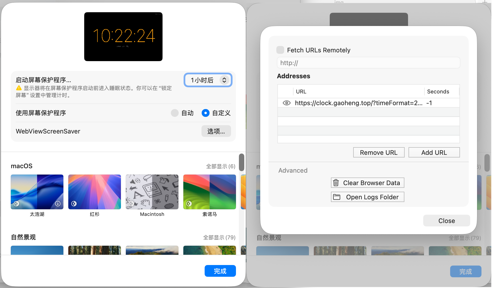
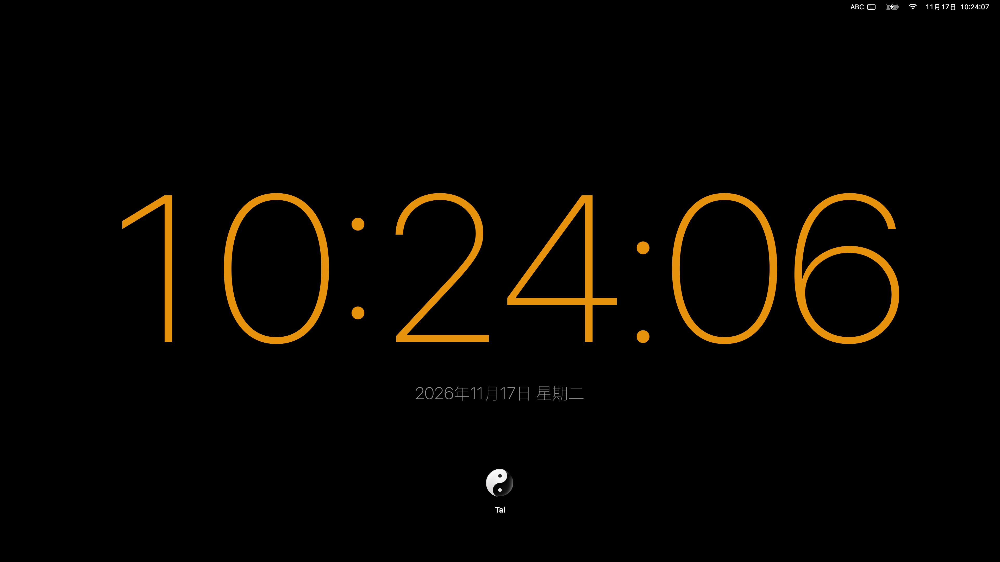

# clock

one clock website for show current time. when you work,you can set it full screen.

## update set for mac

use [webviewscreensaver](https://github.com/liquidx/webviewscreensaver) and set set for mac screen saver by clock url.




The URL is obtained from the settings page.

## Project Setup

> you can use yarn/npm/pnpm run project.

```sh
yarn
```

### Compile and Hot-Reload for Development

```sh
yarn dev
```

### Compile and Minify for Production

```sh
yarn build
```
